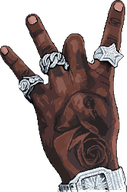
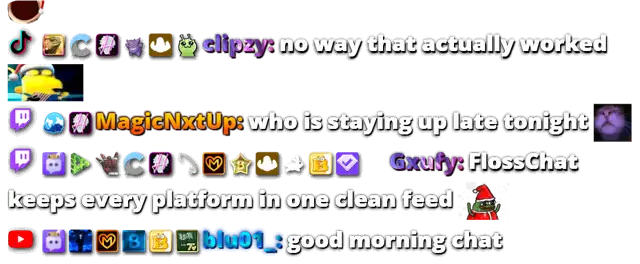
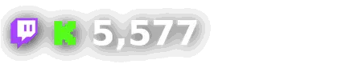
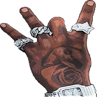
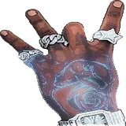
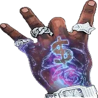
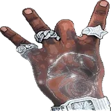

<div align="center">

<h1>
  
  FlossChat
</h1>

**Every chat. One overlay. No login.**

<a href="https://flosschat.app/"></a>


<a href="https://flosschat.app/"></a>

<a href="https://flosschat.app/"></a>

<sub>Chat overlay and FlossCounter, recorded from the live previews on flosschat.app (transparent, as in OBS)</sub>

</div>

## Supported services

<!-- prettier-ignore-start -->
| | Service | What shows |
| :---: | :--- | :--- |
|  | **[Kick](https://kick.com/)** | Chat, emotes, badges, moderation, pins |
|  | **[Twitch](https://www.twitch.tv/)** | Chat, emotes, badges, moderation, Shared Chat, pins, Hype Trains |
|  | **[YouTube](https://www.youtube.com/)** | Live chat, emoji, badges, memberships, Super Chats, pins |
|  | **[TikTok](https://www.tiktok.com/)** | Comments, badges, gifts, subscriptions, follows, shares, pins |
|  | **[7TV](https://7tv.app/)** | Emotes (zero-width too), paints, badges |
|  | **[JilTV](https://jiltv.app/)** | Name paints; Twitch emotes with **JilTV Emotes** on |
|  | **[BTTV](https://betterttv.com/)** | Global and channel emotes |
|  | **[FFZ](https://www.frankerfacez.com/)** | Emotes and badges |
<!-- prettier-ignore-end -->

Plus community badges from Chatterino and friends, and FlossChat's own supporter badges.

## Add it to OBS

1. Open **[flosschat.app](https://flosschat.app/)** and type your channel names.
2. Pick a look: fonts, colors, size, animations, paints, badges.
3. Copy the **Chat URL** into an OBS **Browser Source** (750 × 250).
4. Want viewer counts too? Add the **FlossCounter URL** as a second Browser Source.

Links already in your scenes keep working.

## Supporter badges

<!-- prettier-ignore-start -->
|  |  |  |  |
| :---: | :---: | :---: | :---: |
| **Sanctioned** · $5 | **Suvy** · $10 | **Top Suvy** · $20 | **Founder** · first 25 |
<!-- prettier-ignore-end -->

Sign in with Twitch on [flosschat.app](https://flosschat.app/) → **Support** to get one for yourself or gift it, or pick **Custom** for any amount from $5 to $500 and get the best badge it reaches. Tips add up toward the next badge, and it shows beside your name in every FlossChat overlay.

<details>
<summary><b>Chat commands</b> &nbsp;·&nbsp; <code>!flosschat …</code></summary>

<br />

The command must be the **first word** of a message. Moderators and the broadcaster can use them all; anyone can use `paint` for their own name. `!multichat` and `!kickchat` still work as older names.

| Command | What it does |
| :--- | :--- |
| `ping` | Shows **Pong!** for 3 seconds |
| `reload` | Reloads the browser source |
| `stop` | Clears notifications, images and videos |
| `clear` · `pause` · `resume` | Clears chat, holds new messages, lets them through |
| `show` · `hide` | Shows or hides chat (still connected) |
| `kickon` / `kickoff` | Shows or hides Kick chat (also `twitch`, `youtube`, `tiktok`) |
| `sharedon` / `sharedoff` | Twitch Shared Chat on or off |
| `counterbgon` / `counterbgoff` | FlossCounter pill background on or off |
| `animation on\|off\|auto` | Entrance animations; `auto` eases off in busy chat |
| `events on\|off [feature] [on\|off]` | Event cards: `subs`, `gifts`, `raids`, `cheers`, `milestones`, `follows`, `hypetrain`, `redeems` and more |
| `refresh emotes` | Reloads 7TV, BTTV and FFZ emotes |
| `img <url\|emote> [-t s] [-o opacity]` | Fullscreen image or emote |
| `yt <url\|preset> [-t s] [-m]` | Fullscreen YouTube clip (`bruh`, `vine-boom`, `rickroll` …) |
| `tts <message>` | Reads a message aloud |
| `permit` · `unpermit` · `permitted` | Broadcaster: lets a viewer use the safe controls until reload |
| `paint 7tv\|jiltv\|auto` | **Anyone:** which paint your name shows when you wear both |

The full list with examples is under **Commands** on the site.

</details>

<details>
<summary><b>FlossChat badges in other chat clients</b></summary>

<br />

The public badge list, with images in four sizes:

```
GET https://flosschat.app/api/v1/badges
GET https://flosschat.app/api/v1/badges?user=<twitch user id>
```

</details>

---

<div align="center">
  Built by <a href="https://guns.lol/gxufy"><strong>gxufy</strong></a>
</div>
